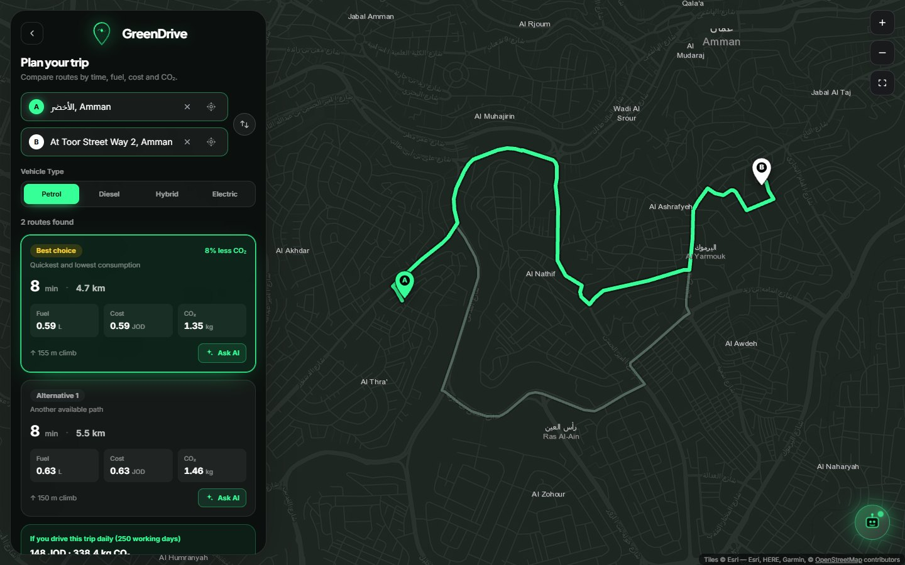
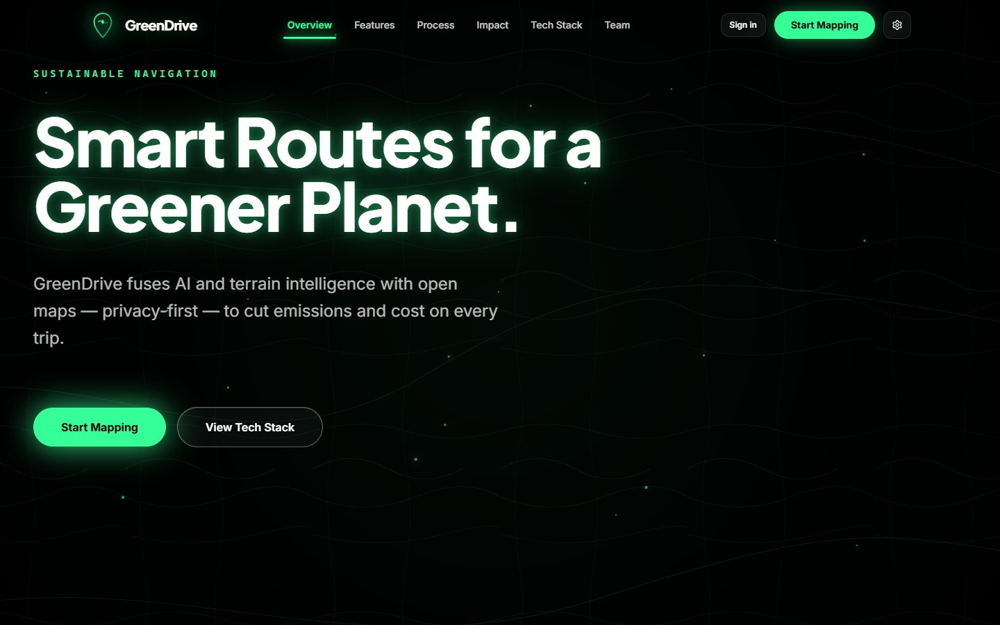
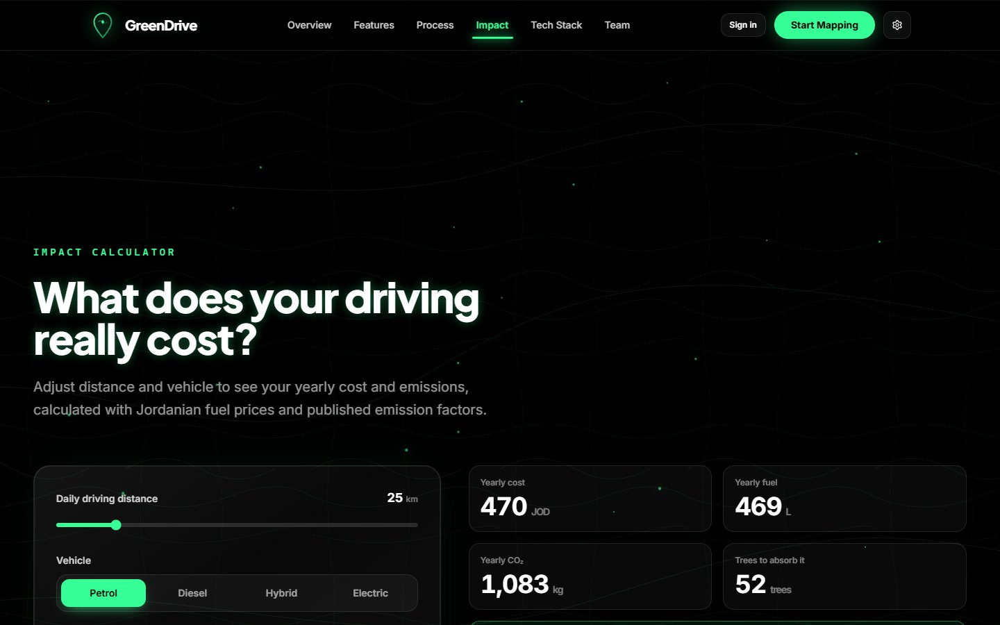
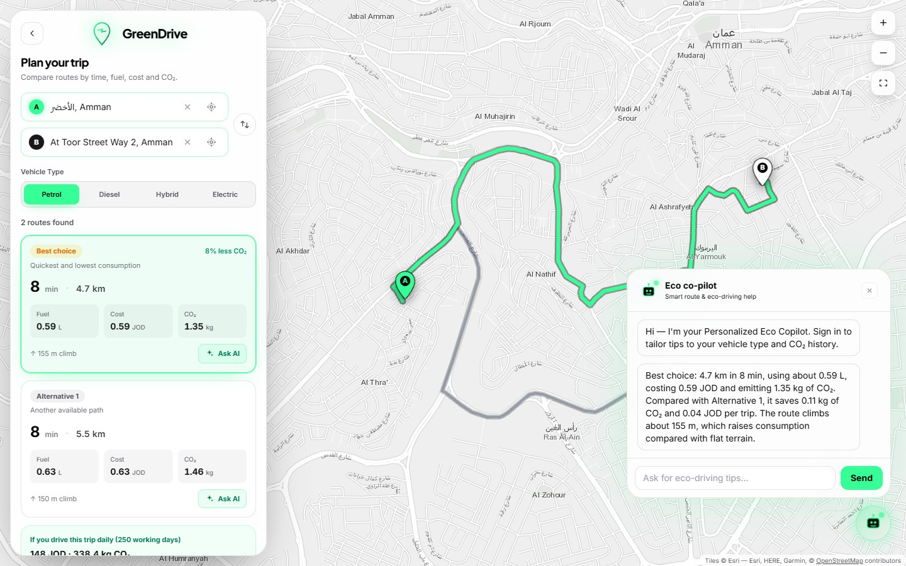
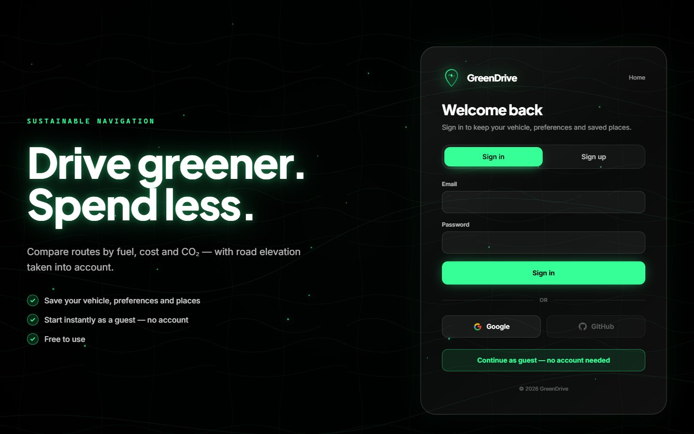
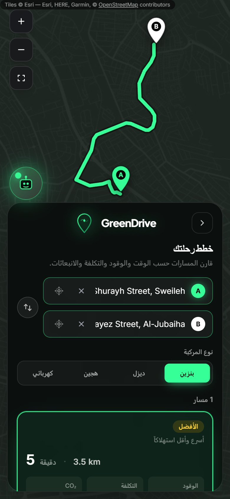

[🏛️ Back to Main Profile](https://github.com/Humam-Taibeh)

# 🌿 GreenDrive

### 🔗 [Live demo → greendrive-5574e.web.app](https://greendrive-5574e.web.app)

> **A route-comparison tool that factors in Amman's hills — not just distance.**
> Built for the Google Antigravity Hackathon, AI for Intelligent Transportation track.

GreenDrive compares real driving routes by **time, fuel, cost (JOD) and CO₂**. Instead of ranking routes by distance alone, it measures the **actual climb** along each route from elevation data, turns it into extra energy with the gravitational-work formula (`mgh`), and prices the result with Jordanian fuel and EV tariffs.

It works **without any account and without any paid API key**: open the map as a guest, pick two points, and compare.



---

## 📸 Screenshots

| | |
|---|---|
|  **Landing page** |  **Impact calculator** — live yearly cost / CO₂ from your own inputs |
|  **Light mode + Eco-Copilot** briefing for the selected route |  **Sign in** — or continue as a guest |

<p align="center">
  
  <br /><sub>Mobile layout, Arabic (RTL)</sub>
</p>

---

## 📽️ The Problem

Amman's steep hills mean distance-based navigation often misses the real cost of a trip: a shorter route with a big climb can burn more fuel than a slightly longer, flatter one.

For every trip GreenDrive requests up to three real alternatives and labels them from the numbers it computes:

* **Best choice** — quickest *and* lowest consumption (when one route wins both).
* **Fastest** / **Most efficient** — when speed and consumption disagree.
* **Alternative N** — other available paths.

Every route card shows time, distance, fuel (or kWh), cost in JOD, CO₂, and the measured climb. Switching vehicle type (petrol, diesel, hybrid, electric) recalculates instantly.

---

## ✨ Features

* **Real routes, free** — OSRM routing on OpenStreetMap data, with place search and draggable A/B pins.
* **Terrain-aware fuel model** — climb measured along each route (Open-Meteo elevation), converted with `mgh`, priced in JOD with Jordanian 2026 tariffs.
* **Impact calculator** — interactive yearly cost / CO₂ / trees estimate. Every number is computed from your inputs, nothing is sample data.
* **Eco-Copilot (optional AI)** — route briefings and eco-driving tips via Gemini / OpenRouter when you provide a key. **Without a key** it still gives a deterministic summary generated from the route numbers.
* **Guest-first** — an account (Firebase: Google or email) is optional and only saves your vehicle, preferences and favourite places.
* **English & Arabic (RTL)**, dark & light themes, responsive down to phones.

---

## 🛠️ How It's Built

### Frontend
* **React 19 + TypeScript + Vite**, **Tailwind CSS v4**
* **Framer Motion** for UI animation, **Three.js / WebGL** for the ambient background
* **RTL-first** layout (English and Arabic)

### Mapping & data (all free, no API key)
| Need | Source |
|---|---|
| Map rendering | [Leaflet](https://leafletjs.com/) |
| Basemap tiles | Esri Canvas (dark gray / light gray), © Esri, HERE, Garmin, © OpenStreetMap contributors |
| Routing | [OSRM](https://project-osrm.org/) public router (OpenStreetMap data) |
| Place search | [Photon](https://photon.komoot.io/) · reverse geocoding via [Nominatim](https://nominatim.org/) |
| Elevation | [Open-Meteo](https://open-meteo.com/) Elevation API (Copernicus DEM, ~90 m) |

### Backend / services
* **Firebase** Authentication + Firestore (optional account features) and **Firebase Hosting**
* Optional AI via **OpenRouter** or the **Gemini API**

### The model (`src/lib/vehicleProfiles.ts`, `src/config/greenDriveConfig.ts`)
* Base consumption per vehicle type + climb energy `W = m·g·h` (engine efficiency applied) × a driving-efficiency factor.
* Fuel prices: Jordan Ministry of Energy, May 2026 pricing decree. EV tariff: EMRC time-of-use. CO₂ factors: IPCC / DEFRA 2023, NEPCO grid intensity.

---

## ⚠️ Limitations (read this)

* **No live traffic.** The free router has none, so durations are free-flow estimates and the app never claims traffic savings.
* **Estimates, not measurements.** Consumption comes from a physics model with typical vehicle figures, not from your car's real data. Elevation is sampled roughly every 400 m from a ~90 m DEM, so very short rolling hills can be under-counted. If elevation can't be fetched, the card says so and assumes flat terrain.
* **Public demo servers** (OSRM, Photon, Nominatim, Esri tiles) are fair-use. For heavy production traffic, self-host them or use a commercial provider.
* The AI briefing is only as good as the numbers it is given; check them in the route cards.

---

## 🚀 Run Locally

```bash
git clone https://github.com/Humam-Taibeh/GreenDrive.git
cd GreenDrive
npm install
cp .env.example .env.local   # all values are optional (see below)
npm run dev                  # http://localhost:5173
```

The map, routing, elevation, calculator and guest mode work with **no keys at all**. Add keys to `.env.local` only for the optional parts:

| Variable | Needed for |
|---|---|
| `VITE_OPENROUTER_API_KEY` (+ `VITE_OPENROUTER_MODEL`) or `VITE_GEMINI_API_KEY` | AI Eco-Copilot (otherwise a local summary is used) |
| `VITE_FIREBASE_*` | Sign-in and saved places |

> ⚠️ Everything prefixed `VITE_` is bundled into the public JavaScript. Never put a secret AI key in a build you publish; restrict it by domain or move calls to a server.

| Script | What it does |
|---|---|
| `npm run dev` | Dev server |
| `npm run build` | Production build (`dist/`) |
| `npm run lint` | ESLint |
| `npm run build:showcase` | Static **design-only** build with no map, AI or Firebase (`.env.showcase`) |

### Deploy (Firebase Hosting)

```bash
npm run build
npx firebase deploy --only hosting --project greendrive-5574e
```

The original Cloud Run setup (`Dockerfile`, `nginx.conf`, `cloudbuild.yaml`) is still in the repo but is not the live deployment.

---

## 🤖 How We Actually Built This

Full transparency on process: this was built by directing AI coding tools — **Claude, Gemini, and Google's Antigravity** — to architect and implement the project within the hackathon timeframe, rather than writing every line manually. That's genuinely how I build: I focus on the idea, the architecture, and the product decisions, and use AI tools (with a lot of prompt iteration) to turn that into working, deployed software. I'm a 3rd-year AI student still building up my core programming fundamentals alongside this — GreenDrive was as much practice in system design and prompt engineering as it was a hackathon submission.

---

## 🏁 For Judges / Reviewers

1. Open the [live demo](https://greendrive-5574e.web.app) and scroll the landing page (try the **Impact calculator**).
2. Click **Start Mapping** — no sign-in needed.
3. Click the map twice (or search) to set **A** and **B**, e.g. two points in Amman with different elevations.
4. Compare the route cards, switch the vehicle type, and click a route to highlight it.
5. Click **Ask AI** for the route briefing. Toggle **Arabic / dark / light** from the settings (gear icon).

---

## 👥 The Team

* **[Humam Taibeh](https://github.com/Humam-Taibeh)** — AI-directed development & architecture
* **[Heba Taibeh](https://github.com/HebaZakwan)** — Product Strategy & UX Design
* **[Natalia Al-Hajawi](https://github.com/silvercreeks14)** — Security & QA

---

## 📄 License

MIT — see [LICENSE](LICENSE).

[🏛️ Back to Main Profile](https://github.com/Humam-Taibeh)
